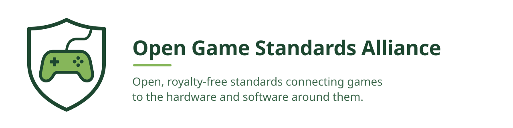
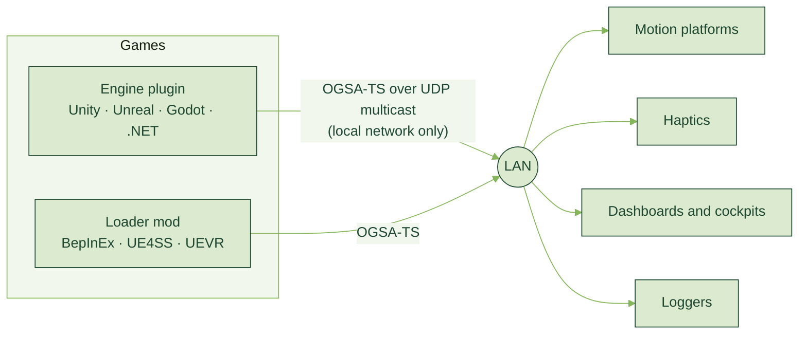

<picture>
  <source media="(prefers-color-scheme: dark)" srcset="assets/banner-dark.svg">
  
</picture>

[](https://github.com/Open-Game-Standards-Alliance/OGSA-Telemetry-Standard/blob/main/LICENSE)
[](https://discord.gg/tseF4Q6U99)
[](https://github.com/sponsors/BrianGilbert)

Games increasingly live alongside other hardware and software: motion rigs,
haptic vests, cockpits, dashboards, companion apps. Today every one of those
connections is built per game, or locked to one vendor's ecosystem, so game
developers have no easy path to the hardware and hardware makers have no easy
path to the games.

The **Open Game Standards Alliance** writes open, royalty-free standards for
these connections, and ships what it takes to adopt them, so that each side
implements a standard once and works with everything else that speaks it.

## How we build standards

Every OGSA standard is built the way the [Telemetry Standard](#ogsa-telemetry-standard-ogsa-ts) was:

- **Open and royalty-free.** MIT licensed, free for anyone to implement,
  from hobbyists to hardware vendors.
- **Local-first.** Standards run between devices the player owns. No cloud,
  no account, nothing leaves the player's network.
- **Adoptable on day one.** A standard ships with SDKs for the major engines
  and a reference implementation, so adding it is a small job, not a
  project. Where developers can't add it themselves, loader mods add it to
  games already on players' machines.
- **Proven, not promised.** Each standard comes with a conformance corpus
  that every implementation is tested against, and is validated against
  real games before it's called done.
- **Developed in the open.** Design discussion, validation evidence and the
  specifications themselves are public.

## Standards

| Standard | What it connects | Status |
| --- | --- | --- |
| [**OGSA Telemetry Standard (OGSA-TS)**](#ogsa-telemetry-standard-ogsa-ts) | Live game telemetry to motion platforms, haptics, dashboards and loggers | Published, v1 |

Have an interoperability problem between games and the hardware or software
around them that a standard should solve? Bring it to
[Discord](https://discord.gg/tseF4Q6U99).

---

## OGSA Telemetry Standard (OGSA-TS)

<picture>
  <source media="(prefers-color-scheme: dark)" srcset="assets/telemetry-standard-dark.svg">
  
</picture>

Motion rigs, haptic vests and instrument dashboards all need the same thing
from a game: what the player's vehicle or character is doing, moment to
moment. Most games ship no telemetry at all, or tie it to one vendor's
ecosystem, so device makers write a reader per game. One motion-software
project alone maintains 72 of them.

[OGSA-TS](https://github.com/Open-Game-Standards-Alliance/OGSA-Telemetry-Standard)
lets a game describe itself once, on the local network, so that every device
listening understands it.



### Find your starting point

| You are... | Start with |
| --- | --- |
| **Making a game in Unity** | [ogsa-ts-unity](https://github.com/Open-Game-Standards-Alliance/ogsa-ts-unity): add a publisher component, bind your values |
| **Making a game in Unreal** | [ogsa-ts-unreal](https://github.com/Open-Game-Standards-Alliance/ogsa-ts-unreal): a plugin with no third-party dependencies |
| **Making a game in Godot 4 (.NET)** | [ogsa-ts-godot](https://github.com/Open-Game-Standards-Alliance/ogsa-ts-godot): an addon with a publisher node |
| **Running a custom .NET engine** | [ogsa-ts-dotnet](https://github.com/Open-Game-Standards-Alliance/ogsa-ts-dotnet): the engine-agnostic core every C# plugin is built on |
| **Building hardware or receiver software** | [ogsa-ts-dotnet](https://github.com/Open-Game-Standards-Alliance/ogsa-ts-dotnet) for the receiving library and a reference receiver, then [IMPLEMENTING.md](https://github.com/Open-Game-Standards-Alliance/OGSA-Telemetry-Standard/blob/main/IMPLEMENTING.md) |
| **Implementing in another language** | [The standard](https://github.com/Open-Game-Standards-Alliance/OGSA-Telemetry-Standard): the schema, the encoding rules and a conformance corpus to test against |
| **Playing a game that has no telemetry** | A [loader mod](#loader-mods) |

<details>
<summary><b>Quick start: Unity</b></summary>

Add the package to `Packages/manifest.json`, pinned to a release:

```json
"com.ogsa.telemetry.unity": "https://github.com/Open-Game-Standards-Alliance/ogsa-ts-unity.git#v0.2.0"
```

Then add **OGSA-TS/Telemetry Publisher** to your vehicle and declare your
channels in code. The package is plain C# source with no precompiled
assemblies, and runs on Mono and IL2CPP.
</details>

<details>
<summary><b>Quick start: Unreal</b></summary>

Drop the plugin into your project's `Plugins/` folder, enable it, add
**TelemetryPublisher** to your vehicle, then in `BeginPlay`:

```cpp
auto Handle = Telemetry->DeclareChannel(TEXT("engine.rpm"), TEXT("rpm"), 0, 9000, true);
Telemetry->BindChannelRaw(Handle, [this]{ return Engine->Rpm; });
```
</details>

<details>
<summary><b>Quick start: Godot 4 (.NET)</b></summary>

Copy `addon/ogsa_telemetry/` into your project as `addons/ogsa_telemetry/`,
then enable **OGSA Telemetry (OGSA-TS)** under Project Settings > Plugins.
Nothing needs adding to your game's csproj.
</details>

<details>
<summary><b>Quick start: see the stream</b></summary>

With any OGSA-TS game running on your network:

```sh
git clone https://github.com/Open-Game-Standards-Alliance/ogsa-ts-dotnet
cd ogsa-ts-dotnet
dotnet run --project src/TelemetryReceive
```

The reference receiver prints the game's channel declarations, live motion
and events, and flags anything that doesn't conform.
</details>

### At a glance

OGSA-TS defines three frames on one UDP multicast group:

- **Discovery**, every two seconds: the game, its objects, and a dictionary
  of channels, each declared once with a name, type, unit and range.
- **Motion**, at the game's telemetry rate: the bare samples, keyed by the
  ids from discovery. A pose-only frame is about 70 bytes.
- **Events**, when they happen: impacts, gunfire and other stimuli, with
  replay and deduplication so a lossy network can't drop them.

It is **read-only**, so it can't be used to cheat, and it **never leaves
the local network**. It is **extensible**: any game can declare its own
channels, and receivers skip fields they don't recognise, so the schema
grows without breaking deployed devices. And it is **precise**: units,
axes and signs are settled once in
[CONVENTIONS.md](https://github.com/Open-Game-Standards-Alliance/OGSA-Telemetry-Standard/blob/main/CONVENTIONS.md),
not rediscovered per game.

- **Validated against real games.** The schema has been mapped against more
  than 100 documented game outputs across 16 exercises with no open gaps,
  including all 1,354 variables Microsoft Flight Simulator 2024 exposes.
- **One canonical encoding.** Every implementation produces byte-identical
  Cap'n Proto for the same frame, proven against a shared
  [conformance corpus](https://github.com/Open-Game-Standards-Alliance/OGSA-Telemetry-Standard/tree/main/conformance)
  that is independently checked with the official Cap'n Proto tools.
- **Proven in shipped games.** The loader mods have run in Subnautica Below
  Zero, The Gunk, Stray and RoboCop: Rogue City, with no changes to the
  games.

### Implementations

| Repository | What it is | CI |
| --- | --- | --- |
| [OGSA-Telemetry-Standard](https://github.com/Open-Game-Standards-Alliance/OGSA-Telemetry-Standard) | The specification, schema, conventions, validation and conformance corpus | [](https://github.com/Open-Game-Standards-Alliance/OGSA-Telemetry-Standard/actions/workflows/ci.yml) |
| [ogsa-ts-dotnet](https://github.com/Open-Game-Standards-Alliance/ogsa-ts-dotnet) | .NET reference implementation: sender core, receiving library, reference receiver | [](https://github.com/Open-Game-Standards-Alliance/ogsa-ts-dotnet/actions/workflows/ci.yml) |
| [ogsa-ts-unity](https://github.com/Open-Game-Standards-Alliance/ogsa-ts-unity) | Unity package (2022.3+ and Unity 6) | [](https://github.com/Open-Game-Standards-Alliance/ogsa-ts-unity/actions/workflows/ci.yml) |
| [ogsa-ts-unreal](https://github.com/Open-Game-Standards-Alliance/ogsa-ts-unreal) | Unreal Engine plugin | [](https://github.com/Open-Game-Standards-Alliance/ogsa-ts-unreal/actions/workflows/ci.yml) |
| [ogsa-ts-godot](https://github.com/Open-Game-Standards-Alliance/ogsa-ts-godot) | Godot 4 (.NET) addon | [](https://github.com/Open-Game-Standards-Alliance/ogsa-ts-godot/actions/workflows/ci.yml) |
| [Motion-Telemetry-Documentation](https://github.com/Open-Game-Standards-Alliance/Motion-Telemetry-Documentation) | Background on motion telemetry concepts | |

Every SDK is plain source with no third-party runtime dependencies, so it
builds wherever its engine builds: Windows, Linux, macOS, ARM, and
ahead-of-time platforms such as IL2CPP.

### Loader mods

OGSA-TS for games that don't ship it, with no changes to the game: each mod
loads through an established mod loader, finds the pawn the player controls,
and publishes its motion. They live under
[@BrianGilbert](https://github.com/BrianGilbert) and are released from CI
on every change.

| Mod | For | Loads through | Validated in | Download |
| --- | --- | --- | --- | --- |
| [bepinex-ogsa-ts](https://github.com/BrianGilbert/bepinex-ogsa-ts) | Unity games, Mono and IL2CPP | BepInEx 5 (Mono), BepInEx 6 (IL2CPP) | Subnautica Below Zero | [Latest release](https://github.com/BrianGilbert/bepinex-ogsa-ts/releases/latest) |
| [ue4ss-ogsa-ts](https://github.com/BrianGilbert/ue4ss-ogsa-ts) | Unreal Engine 4 and 5 games | UE4SS | The Gunk, Stray, RoboCop: Rogue City | [Latest release](https://github.com/BrianGilbert/ue4ss-ogsa-ts/releases/latest) |
| [uevr-ogsa-ts](https://github.com/BrianGilbert/uevr-ogsa-ts) | Unreal Engine 4 and 5 games in VR | UEVR | | [Latest release](https://github.com/BrianGilbert/uevr-ogsa-ts/releases/latest) |

Help with the mods is on the [mod support server](https://discord.gg/yyCp5D2Ccp).

---

## Background

[**A common language for game telemetry**](https://briangilbert.net/writings/local-telemetry-standard/):
where the Telemetry Standard came from, why it kept going quiet, and what
exists now.

<table>
  <tr>
    <td width="50%" valign="top">
      <a href="https://www.youtube.com/watch?v=Jcs6R4Hk9Is"></a><br>
      <b>Leveling Up Gaming: Building a Standard for Epic Gameplay</b>
    </td>
    <td width="50%" valign="top">
      <a href="https://www.youtube.com/watch?v=Nq0YSA0Q6O4"></a><br>
      <b>Overview of the iRacing API</b>
    </td>
  </tr>
</table>

## Get involved

- **Talk to us** on [Discord](https://discord.gg/tseF4Q6U99).
- **Propose a standard.** If games and the devices around them keep
  solving the same integration problem one game at a time, that's a
  candidate. Bring the problem and the evidence to Discord.
- **Improve an existing one.** For the Telemetry Standard, shared channel
  names live in the
  [Common Channels annex](https://github.com/Open-Game-Standards-Alliance/OGSA-Telemetry-Standard/blob/main/CHANNELS.md);
  new entries need evidence from at least two games.
- **Contribute** issues and pull requests to any repository here.
- **Sponsor the work** through
  [GitHub Sponsors](https://github.com/sponsors/BrianGilbert). It funds the
  specifications, validation and SDKs.

<sub>Founded by [Brian Gilbert](https://github.com/BrianGilbert) in 2024 and developed in the open. Everything here is MIT licensed and free for anyone to implement, from hobbyists to hardware vendors.</sub>
